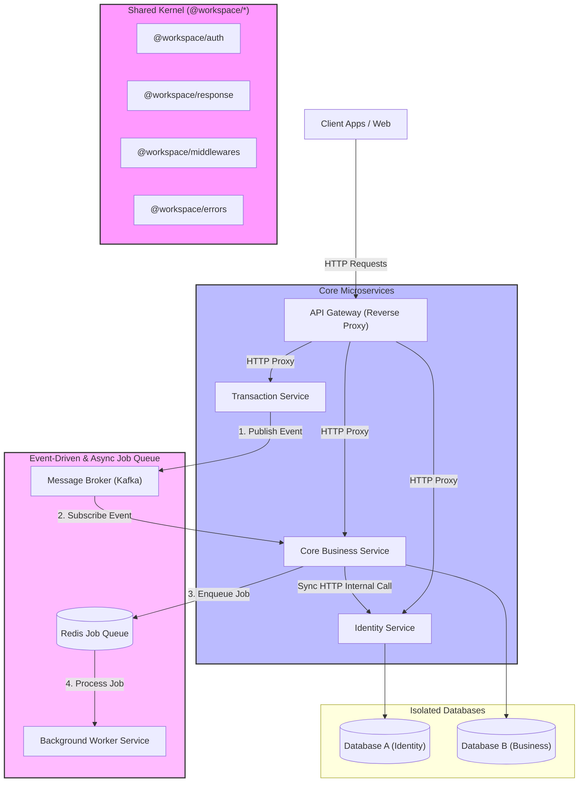

# Hướng Dẫn Thiết Lập & Quy Chuẩn Lập Trình Microservice (Node.js/Express 5)

Tài liệu này cung cấp hướng dẫn từng bước, quy tắc thiết kế kiến trúc và các quy chuẩn code (coding conventions) để xây dựng một dự án backend microservices mới từ đầu. Kiến trúc này kế thừa những best practices từ hệ thống backend **Nextstay** (`nextstaybe-v2`), sử dụng **npm workspaces**, **Express 5**, **Sequelize** làm ORM, **Kafka** làm Event Broker và **BullMQ** làm Job Queue.

---

## 1. Kiến Trúc Tổng Quan & Quy Ước Thiết Kế (Architecture Overview & Design Patterns)

Khi thiết lập một dự án backend microservices mới, hệ thống cần được xây dựng dựa trên các nguyên tắc và mô hình kiến trúc chuẩn sau:



### 1.1. Nguyên Tắc Tổ Chức Monorepo (Workspaces Pattern)

- **Quy ước**: Toàn bộ dự án được quản lý trong một Git Repository duy nhất (Monorepo) sử dụng **npm/yarn workspaces**.
- **Mục tiêu**:
  - Quản lý tập trung các dependencies (third-party packages) ở root level.
  - Cho phép các microservice dễ dàng tái sử dụng mã nguồn dùng chung thông qua cơ chế liên kết gói cục bộ (local package symlink) mà không cần build hay publish lên registry ngoài.

### 1.2. Nguyên Tắc Thiết Kế API Gateway (Gateway Routing Pattern)

- **Quy ước**: Client không bao giờ kết nối trực tiếp tới các microservice bên dưới. Tất cả request đều đi qua API Gateway làm cổng giao tiếp duy nhất.
- **Ràng buộc thiết kế**:
  - API Gateway chỉ làm nhiệm vụ định tuyến proxy (Reverse Proxy), cấu hình CORS tập trung, SSL Termination, và ghi nhận log tracing (tự động tạo `x-request-id` đính kèm vào HTTP Header).
  - **TUYỆT ĐỐI KHÔNG** viết logic nghiệp vụ (business logic) hay kết nối trực tiếp database tại Gateway.

### 1.3. Nguyên Tắc Độc Lập Dữ Liệu (Database-per-Service Pattern)

- **Quy ước**: Mỗi microservice phải hoàn toàn độc lập về mặt lưu trữ. Một dịch vụ chỉ được phép đọc/ghi trực tiếp vào cơ sở dữ liệu (Database) do chính nó quản lý.
- **Ràng buộc thiết kế**:
  - **KHÔNG** kết nối chéo database giữa các dịch vụ.
  - Nếu `Service A` cần dữ liệu từ `Service B`, nó bắt buộc phải gọi thông qua API nội bộ (Synchronous HTTP) hoặc nhận thông tin thay đổi qua Event-Driven (Asynchronous Kafka).

### 1.4. Nguyên Tắc Chia Sẻ Mã Nguồn (Shared Kernel Pattern)

- **Quy ước**: Các đoạn mã nguồn lặp đi lặp lại (như định dạng JSON phản hồi, xử lý lỗi global, middleware kiểm tra quyền, v.v.) phải được trích xuất thành các thư viện nội bộ nằm trong thư mục `packages/`.
- **Ràng buộc thiết kế**: Các gói dùng chung này phải giữ mức độ độc lập cao, hạn chế tối đa việc tạo dependencies vòng (circular dependencies) hoặc quá chặt chẽ (tight coupling) giữa chúng.

### 1.5. Nguyên Tắc Giao Tiếp Giữa Các Dịch Vụ (Communication Patterns)

- **Giao Tiếp Đồng Bộ (Synchronous)**: Sử dụng HTTP REST (hoặc gRPC) khi cần lấy dữ liệu ngay lập tức giữa các service. Bắt buộc cấu hình timeout ngắn (tối đa 3 giây) và xác thực an toàn bằng Header API Key nội bộ.
- **Giao Tiếp Bất Đồng Bộ (Asynchronous)**: Sử dụng mô hình Event-Driven qua Message Broker (Kafka) để truyền thông tin cập nhật trạng thái chéo giữa các service độc lập nhằm tránh nghẽn luồng.
- **Background Jobs**: Kết hợp **BullMQ + Redis** để quản lý các hàng đợi công việc ngầm của riêng từng service (ví dụ: gửi mail, xử lý file). Tách biệt các tác vụ nặng ra các container Worker chuyên dụng để bảo vệ hiệu năng của API chính.

---

## 2. Khởi Tạo Cấu Trúc Monorepo (Scaffolding)

### 2.1. Cấu Trúc Thư Mục Chuẩn

Khi thiết lập một dự án mới, hãy tạo cấu trúc thư mục như sau:

```text
my-project/
├── gateway/                 # API Gateway
│   ├── server.js            # Entrypoint của Gateway
│   └── package.json
├── packages/                # Các thư viện dùng chung (Shared Packages)
│   ├── auth/                # Gói xác thực JWT, session cookies, middleware
│   ├── errors/              # Định nghĩa lỗi tùy chỉnh (Custom HTTP Errors)
│   ├── middlewares/         # Middleware dùng chung (error handler, not found)
│   └── response/            # Chuẩn hóa response API & xử lý phân trang
├── services/                # Các microservices độc lập
│   ├── identity-service/    # Service quản lý User/Auth
│   ├── business-service/    # Service nghiệp vụ chính
│   │   ├── src/
│   │   │   ├── configs/     # Cấu hình DB, Redis, App
│   │   │   ├── controllers/ # Định nghĩa các controller
│   │   │   ├── db/          # Migrations và Seeders
│   │   │   ├── models/      # Sequelize Models
│   │   │   ├── routes/      # Định nghĩa các routes (API, Admin, Internal)
│   │   │   ├── services/    # Tầng xử lý logic nghiệp vụ
│   │   │   ├── utils/       # Helpers, DTOs, Query Builders
│   │   │   └── validators/  # Cấu trúc validate request
│   │   ├── server.js        # Entrypoint của service
│   │   └── package.json
│   └── ...
├── docker-compose.yml       # Setup môi trường Docker chạy local
├── Dockerfile               # Dockerfile chung cho monorepo
└── package.json             # Root package.json cấu hình npm workspaces
```

### 2.2. Thiết Lập Root `package.json`

Tại thư mục gốc dự án, khởi tạo file `package.json` định nghĩa workspaces:

```json
{
  "name": "my-microservice-project",
  "version": "1.0.0",
  "private": true,
  "workspaces": ["packages/*", "services/*", "gateway"]
}
```

---

## 3. Phát Triển Các Shared Gói (Shared Packages)

Các shared packages nằm tại thư mục `packages/` được import chéo vào các service qua npm workspaces. Dưới đây là mã nguồn tiêu chuẩn để cài đặt chúng:

### 3.1. Gói Xử Lý Phản Hồi (`packages/response`)

Dùng để chuẩn hóa định dạng JSON trả về cho client và parse tham số phân trang.

- `packages/response/package.json`:
  ```json
  {
    "name": "@workspace/response",
    "version": "1.0.0",
    "main": "src/index.js",
    "private": true
  }
  ```
- `packages/response/src/index.js`:

  ```javascript
  "use strict";

  function responseEnhancer(req, res, next) {
    res.success = function (statusCode, data, message = "OK") {
      if (statusCode === 204) return res.status(204).end();
      return res.status(statusCode).json({ success: true, message, data });
    };

    res.error = function (statusCode, message, errors = null) {
      const body = { success: false, message };
      if (errors) body.errors = errors;
      return res.status(statusCode).json(body);
    };

    res.paginate = function ({ items, total }) {
      const page = req.page || 1;
      const limit = req.limit || 20;
      return res.status(200).json({
        success: true,
        message: "OK",
        data: {
          items,
          pagination: {
            page,
            limit,
            total,
            pages: Math.ceil(total / limit),
          },
        },
      });
    };
    next();
  }

  function handlePagination(req, res, next) {
    const page = Math.max(1, parseInt(req.query.page, 10) || 1);
    const limit = Math.min(
      100,
      Math.max(1, parseInt(req.query.limit, 10) || 20),
    );
    req.page = page;
    req.limit = limit;
    next();
  }

  module.exports = { responseEnhancer, handlePagination };
  ```

### 3.2. Gói Định Nghĩa Lỗi Nghiệp Vụ (`packages/errors`)

- `packages/errors/src/index.js`:

  ```javascript
  "use strict";

  function throwError(statusCode, message, errors = null) {
    const err = new Error(message);
    err.statusCode = statusCode;
    if (errors) err.errors = errors;
    throw err;
  }

  module.exports = { throwError };
  ```

### 3.3. Gói Middleware Chung (`packages/middlewares`)

Cung cấp middleware xử lý lỗi global và route không tồn tại.

- `packages/middlewares/src/errorHandler.js`:

  ```javascript
  "use strict";

  function errorHandler(err, req, res, next) {
    const statusCode = err.statusCode || err.status || 500;
    const message = err.message || "Internal Server Error";

    if (statusCode >= 500) {
      console.error("[Fatal Error]", err);
    }

    return res.status(statusCode).json({
      success: false,
      message,
      ...(err.errors ? { errors: err.errors } : {}),
    });
  }

  module.exports = errorHandler;
  ```

- `packages/middlewares/src/notFoundHandler.js`:

  ```javascript
  "use strict";

  function notFoundHandler(req, res) {
    return res.status(404).json({
      success: false,
      message: `Cannot ${req.method} ${req.originalUrl}`,
    });
  }

  module.exports = notFoundHandler;
  ```

### 3.4. Gói Client Gọi API Nội Bộ (`packages/internal-client`)

Cung cấp SDK client dùng chung để gọi các API nội bộ giữa các microservices một cách bảo mật, xử lý lỗi và timeout tập trung. Gói này được thiết kế theo phong cách Functional/Object-based để tránh lỗi con trỏ `this`.

- `packages/internal-client/package.json`:

  ```json
  {
    "name": "@workspace/internal-client",
    "version": "1.0.0",
    "main": "src/index.js",
    "private": true,
    "dependencies": {
      "axios": "^1.7.9",
      "@workspace/errors": "^1.0.0"
    }
  }
  ```

- `packages/internal-client/src/httpClient.js` (Axios Factory Function):

  ```javascript
  "use strict";

  const axios = require("axios");
  const { throwError } = require("@workspace/errors");

  function createHttpClient(baseURL) {
    const client = axios.create({
      baseURL,
      timeout: parseInt(process.env.INTERNAL_HTTP_TIMEOUT, 10) || 3000,
      headers: {
        "Content-Type": "application/json",
      },
    });

    client.interceptors.request.use(
      (config) => {
        config.headers["x-internal-key"] = process.env.INTERNAL_API_KEY;
        return config;
      },
      (error) => Promise.reject(error),
    );

    client.interceptors.response.use(
      (response) => {
        return response.data?.data ?? response.data;
      },
      (error) => {
        if (error.response) {
          const { status, data } = error.response;
          throwError(
            status,
            data?.message || "Internal Service Error",
            data?.errors,
          );
        } else if (error.code === "ECONNABORTED") {
          throwError(504, "Target service response timeout.");
        } else {
          throwError(503, "Target service is temporarily unavailable.");
        }
      },
    );

    return client;
  }

  module.exports = createHttpClient;
  ```

- `packages/internal-client/src/services/identity.js` (SDK Client cho Identity Service):

  ```javascript
  "use strict";

  const createHttpClient = require("../httpClient");

  const baseURL =
    process.env.IDENTITY_SERVICE_INTERNAL_URL || "http://localhost:2003";
  const http = createHttpClient(baseURL);

  const identityClient = {
    async getIdentityInfo(userId) {
      try {
        return await http.get(`/internal/users/${userId}`);
      } catch (error) {
        if (error.statusCode === 404) {
          return null;
        }
        throw error;
      }
    },
  };

  module.exports = identityClient;
  ```

- `packages/internal-client/src/index.js` (Export Entrypoint):

  ```javascript
  "use strict";

  const identityClient = require("./services/identity");

  module.exports = {
    identityClient,
  };
  ```

### 3.5. Gói Xác Thực & Phân Quyền (`packages/auth`)

Cung cấp các hàm tạo, giải mã mã JWT token, quản lý cookie và các middleware phân quyền dùng chung cho các service.

- `packages/auth/package.json`:

  ```json
  {
    "name": "@workspace/auth",
    "version": "1.0.0",
    "main": "src/index.js",
    "private": true,
    "dependencies": {
      "jsonwebtoken": "^9.0.2"
    }
  }
  ```

- `packages/auth/src/index.js`:

  ```javascript
  "use strict";

  const jwt = require("jsonwebtoken");

  const authConfig = {
    get JWT_SECRET() {
      const secret = process.env.JWT_SECRET_KEY;
      if (!secret || secret.length < 32) {
        throw new Error("JWT_SECRET_KEY must be at least 32 characters.");
      }
      return secret;
    },
    get JWT_EXPIRES_IN() {
      return parseInt(process.env.JWT_EXPIRES_IN, 10) || 86400; // Mặc định 1 ngày
    },
    get REFRESH_TOKEN_EXPIRES_IN() {
      return parseInt(process.env.REFRESH_TOKEN_EXPIRES_IN, 10) || 2592000; // 30 ngày
    },
    TOKEN_TYPE: "Bearer",
  };

  // Quản lý lưu trữ token qua Cookie cho REST API
  class CookieManager {
    constructor() {
      this.cookieOptions = {
        httpOnly: true,
        secure: process.env.NODE_ENV === "production",
        sameSite: process.env.NODE_ENV === "production" ? "none" : "lax",
        path: "/",
      };
    }

    setAuthCookies(res, { accessToken, refreshToken, rememberMe = false }) {
      const maxAgeAccess = authConfig.JWT_EXPIRES_IN * 1000;
      const maxAgeRefresh = rememberMe
        ? authConfig.REFRESH_TOKEN_EXPIRES_IN * 1000
        : 24 * 60 * 60 * 1000; // 1 ngày nếu không chọn remember me

      res.cookie("accessToken", accessToken, {
        ...this.cookieOptions,
        maxAge: maxAgeAccess,
      });
      if (refreshToken) {
        res.cookie("refreshToken", refreshToken, {
          ...this.cookieOptions,
          maxAge: maxAgeRefresh,
        });
      }
      return true;
    }

    clearAuthCookies(res) {
      res.clearCookie("accessToken", this.cookieOptions);
      res.clearCookie("refreshToken", this.cookieOptions);
      return true;
    }

    getAccessToken(req) {
      return req.cookies?.accessToken || null;
    }
  }

  const cookieManager = new CookieManager();

  // Tạo và xác thực JWT token
  function generateToken(
    payload,
    secret = authConfig.JWT_SECRET,
    expiresIn = authConfig.JWT_EXPIRES_IN,
  ) {
    return jwt.sign(payload, secret, { expiresIn });
  }

  function verifyToken(token, secret = authConfig.JWT_SECRET) {
    try {
      return jwt.verify(token, secret);
    } catch (err) {
      const error = new Error("Invalid or expired token.");
      error.statusCode = 401;
      throw error;
    }
  }

  // Middleware xác thực người dùng chung (User Auth Middleware)
  function userAuth(req, res, next) {
    try {
      const token =
        cookieManager.getAccessToken(req) ||
        req.headers.authorization?.split(" ")[1];
      if (!token) {
        const err = new Error("Access token is required.");
        err.statusCode = 401;
        throw err;
      }
      const payload = verifyToken(token);
      req.userId = payload.userId;
      req.userRole = payload.role;
      next();
    } catch (err) {
      next(err);
    }
  }

  // Middleware phân quyền Admin (Admin Auth Middleware)
  function requireAdmin(req, res, next) {
    if (!req.userId) {
      const err = new Error("Authentication required.");
      err.statusCode = 401;
      return next(err);
    }
    if (req.userRole !== "admin") {
      const err = new Error("Forbidden: Admin access required.");
      err.statusCode = 403;
      return next(err);
    }
    next();
  }

  module.exports = {
    authConfig,
    cookieManager,
    generateToken,
    verifyToken,
    userAuth,
    requireAdmin,
  };
  ```

---

## 4. Xây Dựng API Gateway

API Gateway chịu trách nhiệm định tuyến proxy tới các service bên dưới, đồng thời giải quyết bài toán CORS và Logging/Tracing.

- `gateway/package.json`:
  ```json
  {
    "name": "gateway",
    "version": "1.0.0",
    "main": "server.js",
    "dependencies": {
      "cors": "^2.8.5",
      "express": "^5.1.0",
      "http-proxy-middleware": "^3.0.0"
    }
  }
  ```
- `gateway/server.js`:

  ```javascript
  "use strict";

  const express = require("express");
  const cors = require("cors");
  const { createProxyMiddleware } = require("http-proxy-middleware");
  const crypto = require("crypto");

  const app = express();

  app.use(cors({ origin: true, credentials: true }));

  // Tracing request
  app.use((req, res, next) => {
    req.headers["x-request-id"] = crypto.randomUUID();
    console.log(
      `[Gateway] ${req.method} ${req.url} - Tracing ID: ${req.headers["x-request-id"]}`,
    );
    next();
  });

  // Proxy định tuyến đến các microservice
  app.use(
    createProxyMiddleware({
      target: process.env.AUTH_SERVICE_URL || "http://localhost:2003",
      changeOrigin: true,
      pathFilter: ["/api/v1/auth", "/api/v1/users"],
    }),
  );

  app.use(
    createProxyMiddleware({
      target: process.env.BUSINESS_SERVICE_URL || "http://localhost:2000",
      changeOrigin: true,
      pathFilter: "/api/v1", // Fallback cho các endpoint nghiệp vụ khác
    }),
  );

  // Xử lý lỗi Gateway
  app.use((err, req, res, next) => {
    console.error("[Gateway Error]", err);
    res.status(500).json({ success: false, message: "Gateway Error" });
  });

  const PORT = process.env.GATEWAY_PORT || 2080;
  app.listen(PORT, () => console.log(`🚀 Gateway running on port ${PORT}`));
  ```

---

## 5. Thiết Lập Một Microservice Mới Tiêu Chuẩn

Dưới đây là quy chuẩn khi viết code cho một microservice mới:

### 5.1. File `server.js` Khởi Chạy Service

Mỗi service cần khởi chạy Express 5, tích hợp các shared packages cục bộ và kết nối DB.

- `services/business-service/server.js`:

  ```javascript
  "use strict";

  const express = require("express");
  const cors = require("cors");
  const { responseEnhancer, handlePagination } = require("@workspace/response");
  const { errorHandler, notFoundHandler } = require("@workspace/middlewares");
  const apiRouter = require("./src/routes/api");
  const { sequelize } = require("./src/models"); // Nếu dùng Sequelize

  const app = express();
  const PORT = process.env.PORT || 2000;

  app.use(cors({ origin: true, credentials: true }));
  app.use(express.json());
  app.use(express.urlencoded({ extended: true }));

  app.use(responseEnhancer);
  app.use(handlePagination);

  // Healthcheck endpoint
  app.get("/health", (req, res) => res.success(200, null, "Healthy"));

  app.use("/api/v1", apiRouter);

  app.use(notFoundHandler);
  app.use(errorHandler);

  let server;

  async function start() {
    try {
      // 1. Kiểm tra kết nối DB trước khi mở port
      await sequelize.authenticate();
      console.log("✅ Database connection established successfully.");

      server = app.listen(PORT, () => {
        console.log("🚀 Service is running on port " + PORT);
      });
    } catch (error) {
      console.error("❌ Database connection failed, server exiting:", error);
      process.exit(1);
    }
  }

  async function shutdown(signal) {
    console.log("\n[" + signal + "] Received. Shutting down gracefully...");
    if (server) {
      server.close(async () => {
        console.log("HTTP Server closed.");
        try {
          await sequelize.close();
          console.log("Database connection closed.");
          process.exit(0);
        } catch (err) {
          console.error("Error during graceful shutdown:", err);
          process.exit(1);
        }
      });
    } else {
      process.exit(0);
    }
  }

  process.on("SIGTERM", () => shutdown("SIGTERM"));
  process.on("SIGINT", () => shutdown("SIGINT"));

  start();
  ```

### 5.2. Tầng Controller (Orchestration Layer)

- **Quy tắc & Vai trò**:
  1. **Nhiệm vụ duy nhất (Single Responsibility)**: Chỉ làm nhiệm vụ điều phối. Nhận đầu vào từ HTTP Request (`req.body`, `req.query`, `req.params`), làm sạch/chuẩn hóa tham số (như ép kiểu, phân trang từ `req.page`/`req.limit`), chuyển giao dữ liệu sạch cho Service xử lý, và trả về HTTP Response thống nhất cho Client.
  2. **Cấm chứa Logic Nghiệp vụ**: Tuyệt đối không kiểm tra nghiệp vụ phức tạp, không tương tác trực tiếp với Sequelize Models hay gọi DB query trong Controller.
  3. **Tận dụng Express 5 Async Error Handling**: Không bọc `try-catch` thô. Nếu có lỗi phát sinh trong Service, Express 5 tự động chuyển lỗi đó cho error handler middleware.
  4. **Chuẩn hóa phản hồi**:
     - Lấy dữ liệu thành công: `res.success(200, data)`.
     - Phân trang: `res.paginate(data)`.
     - Tạo mới thành công: `res.success(201, data, "Created successfully")`.
     - Cập nhật/Xóa thành công (không có body): `res.success(204)` (không nội dung) hoặc `res.success(200, null, "Updated successfully")`.

- **Ví dụ Controller nghiệp vụ tiêu chuẩn** (`services/business-service/src/controllers/api/product.controller.js`):

  ```javascript
  "use strict";

  const productService = require("../../services/product.service");

  // Lấy danh sách phân trang (không dùng try-catch)
  exports.getProducts = async (req, res) => {
    const data = await productService.getProducts({
      page: req.page,
      limit: req.limit,
      search: req.query.q,
    });
    res.paginate(data);
  };

  // Tạo bản ghi mới (không dùng try-catch)
  exports.createProduct = async (req, res) => {
    const data = await productService.createProduct(req.body);
    res.success(201, data, "Product created successfully");
  };
  ```

### 5.3. Tầng Service Layer & DTOs (Business Logic & Database Transactions)

- **Quy tắc & Vai trò**:
  1. **Nhiệm vụ duy nhất**: Chứa toàn bộ logic nghiệp vụ (tính toán, kiểm tra quyền hạn, validate nghiệp vụ, điều phối ghi DB, gọi APIs nội bộ và đẩy message lên Kafka Broker).
  2. **Singleton Pattern**: Khai báo và export dưới dạng một Singleton instance duy nhất để dùng chung cho toàn bộ ứng dụng.
  3. **Quản lý Transactions (Giao dịch DB)**:
     - Khi một nghiệp vụ ghi dữ liệu liên quan đến nhiều bảng (ví dụ: tạo Product mới đồng thời tạo ProductDetail và chèn danh sách ProductPhoto), **bắt buộc sử dụng Sequelize Transactions** để đảm bảo tính ACID (toàn vẹn dữ liệu).
     - Luôn ưu tiên dùng **Managed Transactions** (`sequelize.transaction(async (t) => { ... })`) để Sequelize tự động commit khi thành công và rollback khi xảy ra bất kỳ lỗi nào.
     - Phải truyền đối tượng giao dịch `{ transaction: t }` vào tất cả các câu lệnh Sequelize bên trong khối transaction đó.
  4. **Quy tắc DTO (Data Transfer Object)**:
     - Dịch vụ không bao giờ trả về nguyên bản đối tượng model Sequelize (chứa rất nhiều metadata nội bộ và các trường nhạy cảm).
     - Luôn đi qua hàm mapper DTO riêng biệt (trong thư mục `utils/`) để lọc các trường an toàn trước khi trả cho Controller.
     - Sử dụng `raw: true` kết hợp `attributes` chỉ cho các bảng danh mục tĩnh (City, District...) không có dữ liệu nhạy cảm để tăng tối đa hiệu năng.

- **Ví dụ DTO mẫu** (`services/business-service/src/utils/productDto.js`):

  ```javascript
  exports.toProductResponse = (row) => {
    const plain = row.get ? row.get({ plain: true }) : row;
    return {
      id: plain.id,
      title: plain.title,
      price: Number(plain.price || 0),
      status: plain.status,
      details: plain.details
        ? {
            description: plain.details.description || "",
            specifications: plain.details.specifications || "",
          }
        : null,
      createdAt: plain.createdAt,
    };
  };
  ```

- **Ví dụ Service nghiệp vụ phức tạp (Có Transaction & Internal Client Call)** (`services/business-service/src/services/product.service.js`):

  ```javascript
  "use strict";

  const { Product, ProductDetail, sequelize } = require("../models");
  const { throwError } = require("@workspace/errors");
  const { identityClient } = require("@workspace/internal-client"); // Gọi API chéo service
  const { toProductResponse } = require("../utils/productDto");

  class ProductService {
    async getProducts({ page, limit, search }) {
      const offset = (page - 1) * limit;
      const where = {};
      if (search) {
        where.title = { [Op.like]: `%${search}%` };
      }

      const { count, rows } = await Product.findAndCountAll({
        where,
        limit,
        offset,
        order: [["createdAt", "DESC"]],
      });

      return {
        items: rows.map(toProductResponse),
        total: count,
      };
    }

    async createProduct(payload) {
      const { title, price, creatorId, description, specifications } = payload;

      // 1. Gọi API internal kiểm tra sự tồn tại của Creator bên Identity Service
      const creator = await identityClient.getIdentityInfo(creatorId);
      if (!creator) {
        throwError(400, "Invalid creator: User does not exist.");
      }

      // 2. Thực hiện ghi nhiều bảng bằng DB Transaction
      const newProduct = await sequelize.transaction(async (t) => {
        // Ghi bảng chính
        const product = await Product.create(
          {
            title,
            price,
            creatorId,
            status: "pending",
          },
          { transaction: t },
        );

        // Ghi bảng phụ phụ thuộc
        await ProductDetail.create(
          {
            productId: product.id,
            description,
            specifications,
          },
          { transaction: t },
        );

        return product;
      });

      // 3. Lấy lại dữ liệu đầy đủ kèm theo bảng phụ để format qua DTO
      const result = await Product.findByPk(newProduct.id, {
        include: [{ model: ProductDetail, as: "details" }],
      });

      return toProductResponse(result);
    }
  }

  module.exports = new ProductService(); // Export Singleton Instance
  ```

### 5.4. Request Validation với Express Validator

- Validate dữ liệu đầu vào sử dụng thư viện `express-validator`.
- **Ràng buộc thiết kế & Cấu trúc thư mục**:
  - Tách validator thành hai thư mục con riêng biệt: `admin/` (cho các luồng quản trị) và `api/` (cho luồng client/public API) để khớp với cấu trúc `routes` và `controllers`.
  - Viết middleware xử lý lỗi validate chung `handleValidationErrors.js` thành một file riêng nằm trực tiếp trong thư mục `validators/`.
- > [!IMPORTANT]
  > Phải tra cứu rõ cú pháp của thư viện validator đang dùng với phiên bản mới nhất trước khi áp dụng để đảm bảo tính chính xác (ví dụ các thuộc tính như `in: ['params']`, `path`, `param` có thể thay đổi tùy phiên bản `express-validator`).

- **Cấu trúc file xử lý lỗi validate riêng biệt** (`services/business-service/src/validators/handleValidationErrors.js`):

  ```javascript
  "use strict";

  const { validationResult } = require("express-validator");

  const handleValidationErrors = (req, res, next) => {
    const errors = validationResult(req);
    if (!errors.isEmpty()) {
      const first = errors.array({ onlyFirstError: true })[0];
      const field = first?.path ?? first?.param;
      const baseMsg = first?.msg ?? "Validation failed.";
      const message = `${field}: ${baseMsg}`;
      return res.error(422, message, errors.array()); // Trả lỗi validate chuẩn 422
    }
    return next();
  };

  module.exports = handleValidationErrors;
  ```

- **File Validator nghiệp vụ** (`services/business-service/src/validators/api/product.validator.js`):

  ```javascript
  "use strict";

  const { checkSchema } = require("express-validator");
  const handleValidationErrors = require("../handleValidationErrors");

  exports.getProductDetail = [
    checkSchema({
      id: {
        in: ["params"],
        isUUID: { errorMessage: "Product ID must be a valid UUID" },
      },
    }),
    handleValidationErrors,
  ];
  ```

---

## 6. Thiết Lập Giao Tiếp Liên Dịch Vụ (Inter-service Communication)

### 6.1. Đồng Bộ (Sync HTTP REST nội bộ)

- Dùng cho các tác vụ cần lấy dữ liệu ngay lập tức giữa các service.
- **Quy tắc & Kiến trúc**:
  1. **Không kết nối chéo Database**: Các service bắt buộc phải gọi thông qua API HTTP nội bộ để lấy dữ liệu chéo.
  2. **Tách biệt Server và Client (SDK)**:
     - **Server-side Controllers**: Các controllers nội bộ (ví dụ: `controllers/internal/*` truy vấn database cục bộ) **bắt buộc** phải đặt tại thư mục nguồn của Service cung cấp API. Không đưa Controllers vào package dùng chung vì sẽ vi phạm tính độc lập DB.
     - **Client-side SDK**: Các hàm gọi HTTP REST qua Axios được đóng gói tập trung vào package chung `@workspace/internal-client` để các service khác import và gọi nhanh.
  3. **Bảo mật mạng nội bộ**: Giao tiếp trực tiếp qua mạng Docker (không qua API Gateway), bắt buộc kiểm tra header `x-internal-key` khớp với `process.env.INTERNAL_API_KEY`.
  4. **Timeout**: Thiết lập timeout tối đa 3 giây để tránh làm nghẽn luồng xử lý chính của service gửi.

- **Middleware xác thực ở Service cung cấp API** (`src/middlewares/internalAuth.js`):

  ```javascript
  module.exports = (req, res, next) => {
    const key = req.headers["x-internal-key"];
    if (key !== process.env.INTERNAL_API_KEY) {
      return res
        .status(403)
        .json({
          success: false,
          message: "Forbidden: Invalid internal API Key",
        });
    }
    next();
  };
  ```

- **Hàm gọi ở Service tiêu thụ API** (Sử dụng `@workspace/internal-client`):

  ```javascript
  const { identityClient } = require("@workspace/internal-client");

  async function getUserProfile(userId) {
    // Tự động được cấu hình timeout, header key và bóc tách dữ liệu sạch (.data.data)
    const user = await identityClient.getIdentityInfo(userId);
    if (!user) {
      // Xử lý khi không tìm thấy user
    }
    return user;
  }
  ```

### 6.2. Bất Đồng Bộ (Async Event-Driven & Job Queue)

Sự kết hợp giữa **Kafka** (truyền thông điệp giữa các microservice) và **BullMQ** (quản lý job chạy ngầm nội bộ của từng service):

```text
[Payment Service]
       │
       ▼ (Publish Event)
 ─── Kafka Topic: "order.paid" ───
       │
       ▼ (Subscribe & Update Local DB)
[Inventory Service (Kafka Consumer)]
       │
       ▼ (Enqueue Async Task)
 ─── BullMQ / Redis: "inventory.reconciliation" ───
       │
       ▼ (Process Async Task: Update Stock & Log)
[Inventory Worker (BullMQ Worker)]
```

- **Quy tắc**:
  - Không thực hiện các tác vụ nặng (như gửi email, nén file, xử lý ảnh) ngay trong luồng xử lý REST API hay hàm callback của Kafka Consumer.
  - Khi nhận được Event từ Kafka, hãy cập nhật trạng thái dữ liệu nhanh nhất có thể, sau đó đẩy công việc xử lý tiếp theo vào hàng đợi BullMQ để Worker của service xử lý bất đồng bộ.

---

## 7. Dockerization & Graceful Shutdown

### 7.1. Cấu Hình Dockerfile Monorepo Chung

Sử dụng Dockerfile đa tầng (Multi-stage) để cache dependency hiệu quả cho monorepo workspaces.

- `Dockerfile`:

  ```dockerfile
  FROM node:24-alpine

  WORKDIR /app

  # Copy root package files
  COPY package*.json ./

  # Copy code của packages và services
  COPY packages/ packages/
  COPY services/ services/
  COPY gateway/ gateway/

  # Install và build symlinks tự động cho npm workspaces
  RUN npm install --omit=dev

  CMD ["npm", "start"]
  ```

- Khởi chạy các container bằng cách trỏ thuộc tính `working_dir` và `command` trong `docker-compose.yml`:
  ```yaml
  services:
    gateway:
      build: .
      working_dir: /app/gateway
      command: node server.js
      ports:
        - "2080:2080"
  ```

### 7.2. Graceful Shutdown (Tắt An Toàn Tối Giản)

- **Quy tắc**: Để tránh bị mất mát dữ liệu hoặc làm ngắt quãng các request hiện tại khi scale container, bắt buộc lắng nghe các tín hiệu kết thúc hệ thống như `SIGTERM` (lệnh dừng từ container manager như Docker/Kubernetes) hoặc `SIGINT` (`Ctrl+C`).
- **Triết lý thiết kế tối giản**:
  - Chỉ cần dừng HTTP Server Express (`server.close()`) để không nhận request mới và đóng kết nối Database chính (`sequelize.close()`).
  - Đối với các client socket ngầm kết nối tới Redis, Kafka Broker, BullMQ... không cần viết code đóng thủ công rườm rà. Khi tiến trình Node kết thúc (`process.exit(0)`), hệ điều hành và môi trường mạng của Container sẽ tự động thu hồi và đóng toàn bộ các kết nối socket TCP mở một cách an toàn và giải phóng tài nguyên.
- **Mẫu mã nguồn Graceful Shutdown chuẩn hóa**:

  ```javascript
  let server;

  // ...Khởi chạy Express và lưu thực thể vào biến "server"

  async function shutdown(signal) {
    console.log("\n[" + signal + "] Received. Shutting down gracefully...");
    if (server) {
      server.close(async () => {
        console.log("HTTP Server closed.");
        try {
          if (sequelize) {
            await sequelize.close();
            console.log("Database connection closed.");
          }
          process.exit(0);
        } catch (err) {
          console.error("Error during graceful shutdown:", err);
          process.exit(1);
        }
      });
    } else {
      process.exit(0);
    }
  }

  // Lắng nghe tín hiệu tắt từ Docker Container
  process.on("SIGTERM", () => shutdown("SIGTERM"));
  process.on("SIGINT", () => shutdown("SIGINT"));
  ```

---

## 8. Thiết Lập Cơ Sở Dữ Liệu & Quy Chuẩn Migration (Sequelize)

Mỗi microservice có cơ sở dữ liệu riêng biệt. Tuy nhiên, việc cấu hình và quản lý cơ sở dữ liệu cần phải thống nhất trên toàn monorepo để đảm bảo tính dễ bảo trì.

### 8.1. Cấu hình `.sequelizerc` và Thư mục DB

Tránh việc Sequelize CLI sinh các thư mục mặc định ở ngoài root của service. Bắt buộc gom toàn bộ code DB vào trong `src/db/` và `src/models/`:

- `services/business-service/.sequelizerc`:

  ```javascript
  const path = require("path");

  module.exports = {
    config: path.resolve("src", "configs", "database.js"),
    "models-path": path.resolve("src", "models"),
    "seeders-path": path.resolve("src", "db", "seeders"),
    "migrations-path": path.resolve("src", "db", "migrations"),
  };
  ```

### 8.2. Cấu hình `src/configs/database.js`

Trong kiến trúc Monorepo, file `.env` được lưu tập trung tại thư mục gốc của toàn dự án. Cấu hình database cần sử dụng đường dẫn tương đối để giải quyết biến môi trường chung:

- `services/business-service/src/configs/database.js`:

  ```javascript
  "use strict";

  const path = require("path");
  // Load file .env tại thư mục gốc của Monorepo (đi qua 4 cấp thư mục)
  require("dotenv").config({
    path: path.resolve(__dirname, "..", "..", "..", "..", ".env"),
  });

  const baseConfig = {
    username: process.env.DB_USER || "root",
    password: process.env.DB_PASS || "root",
    database: process.env.DB_BUSINESS_NAME || "ns-business",
    host: process.env.DB_HOST || "localhost",
    port: parseInt(process.env.DB_PORT, 10) || 3306,
    dialect: "mysql",
    dialectOptions: {
      bigNumberStrings: true,
    },
    timezone: "+07:00",
    logging: false,
  };

  module.exports = {
    development: { ...baseConfig },
    test: { ...baseConfig },
    production: { ...baseConfig },
  };
  ```

### 8.3. Quy Tắc Đặt Tên File Migration & Seeder (Điều Khiển Thứ Tự Chạy)

Sequelize CLI chạy các file migrations và seeders theo **thứ tự bảng chữ cái (alphabetical order)**.

- **Quy tắc**: Bắt buộc đặt tên file bắt đầu bằng Timestamp dạng `YYYYMMDDHHMMSS` hoặc đánh số tăng dần dạng `000000` ở cuối timestamp để kiểm soát chính xác thứ tự tạo bảng.
- **Quy luật Foreign Key (Khóa ngoại)**:
  - Bảng cha (chứa Primary Key và không phụ thuộc vào ai, ví dụ: `users`, `cities`) **phải được tạo trước** và có timestamp nhỏ hơn.
  - Bảng con (chứa Foreign Key trỏ tới bảng cha, ví dụ: `refresh_tokens` tham chiếu tới `users`, `districts` tham chiếu tới `cities`) **phải được tạo sau** và có timestamp lớn hơn.
  - Nếu vi phạm thứ tự này, lệnh `db:migrate` sẽ bị lỗi crash hệ thống do vi phạm ràng buộc khóa ngoại (Foreign Key Constraint).

**Ví dụ thứ tự đặt tên migrations đúng**:

1. Bảng cha: `20240101000000-create-users.js`
2. Bảng con: `20240101000001-create-refresh-tokens.js` (chứa `userId` references `users(id)`)

**Ví dụ thứ tự đặt tên seeders đúng**:

1. Seed danh mục tĩnh trước: `20260530130001-seed-property-types.js`
2. Seed dữ liệu nghiệp vụ phụ thuộc sau: `20260530130002-seed-listings.js`

### 8.4. Bắt Buộc Đồng Bộ Hóa Giữa Migration và Model

- **Nguyên tắc đồng bộ**: Một thay đổi về cấu trúc bảng (thêm/sửa/xóa cột, đổi kiểu dữ liệu, thiết lập khóa ngoại) chỉ thực sự có hiệu lực trên database khi chạy Migration. Tuy nhiên, để NodeJS app có thể tương tác được với sự thay đổi đó, bạn **bắt buộc phải cập nhật Model tương ứng** trong `src/models/` để ánh xạ chính xác.
- **Quy trình thay đổi Schema DB**:
  1. Sử dụng Sequelize CLI tạo file migration mới: `npm run migration:create -- --name=add-avatar-to-users`.
  2. Viết code trong migration để thêm cột (`queryInterface.addColumn`).
  3. Cập nhật Model `src/models/user.js` bằng cách khai báo thêm trường `avatar` với kiểu dữ liệu tương ứng.
  4. Tuyệt đối không sử dụng `sequelize.sync({ alter: true })` hay `sync({ force: true })` trên production để tránh mất mát dữ liệu.

---

### 8.5. Liên Kết Đến Các Tài Liệu / Skills Sequelize Chuyên Sâu

Để hiểu rõ hơn về các mẫu thiết kế Model hoặc cú pháp viết file Migration/Seeder phức tạp, vui lòng đọc các skill chi tiết sau:

- Hướng dẫn chạy CLI, cấu hình models/index.js và thiết lập Transactions:
  👉 [Sequelize Skill](../../../.agents/skills/sequelize-skill/SKILL.md)
- Hướng dẫn thiết kế Model, định nghĩa trường dữ liệu và cấu hình Associations:
  👉 [Sequelize Models Skill](../../../.agents/skills/sequelize-models/SKILL.md)
